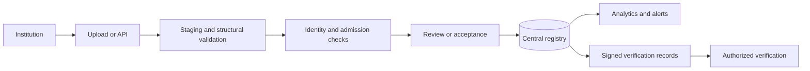

# APAAR Student Registry — Backend Operations & Execution Blueprint

> SIH working blueprint for an APAAR-linked Student Data Management and Verification System for AICTE-approved institutions.
>
> Status: proposed architecture, not an implemented system or an official AICTE/APAAR specification. All API paths, data contracts, targets, and workflows below are project design decisions. Validate official integration requirements before connecting to government systems.

## 1. Mission and boundaries

Build a backend that can answer five questions reliably:

1. Which institution submitted this admission, and was it authorized to do so?
2. Is the student identity verified, pending verification, or disputed?
3. Does this admission fit the institution's approved capacity and category rules?
4. Can an authorized stakeholder verify a limited claim with the student's applicable consent or another approved basis?
5. Can every consequential change be explained from an audit history?

**Core pipeline:**



The product must distinguish data submitted by an institution from facts verified by an authorized identity service. A valid-looking identifier is not proof of identity. A signed record proves the issuer signed those claims; it does not automatically establish the truth of every claim.

### Scope tiers

| Tier | Deliverables | Completion evidence |
|---|---|---|
| P0: working MVP | Authentication, institution isolation, intake configuration, CSV staging, student/admission registry, deterministic validation, basic dashboard, audit trail | Automated integration tests and a complete synthetic demo |
| P1: SIH differentiation | Review queue, explainable anomaly alerts, consent-scoped verification, QR-backed signed records, webhooks | Repeatable end-to-end scenarios and security tests |
| P2: authorized pilot | Official identity integration, institution provisioning authority, production monitoring, backup restoration, reviewed privacy controls | Partner access, operational review, load and recovery evidence |

Do not describe P0 or P1 as a live government integration. Do not collect real student data for the hackathon demo.

## 2. Architecture decisions

### Recommended stack

| Concern | Choice | Reason |
|---|---|---|
| HTTP API | Python 3.12, FastAPI, Pydantic | Typed contracts, OpenAPI, strong validation |
| Persistence | PostgreSQL, SQLAlchemy, Alembic | Transactions, relational constraints, migrations |
| Jobs | Celery with Redis | Upload processing, retries, report generation |
| Files | Private S3-compatible storage; MinIO locally | Isolated imports and exports, short-lived downloads |
| Identity | Standards-based OIDC provider; local test realm for development | Central authentication, MFA support, short-lived access tokens |
| Tests | pytest, HTTPX, real PostgreSQL integration database | Exercise actual transaction and constraint behavior |
| Telemetry | Structured logs, OpenTelemetry, Prometheus-compatible metrics | Correlated requests and operational visibility |
| Packaging | Containers and Compose for local development | Reproducible API, worker, database, and storage services |

Use a **modular monolith** first: one application codebase, one database, separate API and worker processes. Introduce microservices only when measured ownership or scaling needs justify them.

### Modules and ownership

```text
backend/
  app/
    main.py
    core/                  # Settings, auth, authorization, errors, telemetry
    db/                    # Sessions, model base, transaction helpers
    modules/
      institutions/        # Institution provisioning and memberships
      academics/           # Programs, sessions, intake approvals
      students/            # Identity records and provider adapters
      admissions/          # Enrolments, transitions, seat allocations
      imports/             # File staging, jobs, row-level outcomes
      validation/          # Versioned rule engine and findings
      reviews/             # Human resolution and appeals
      verification/        # Consent, requests, signed record access
      analytics/           # Aggregates and reports
      audit/               # Append-only event interface
      integrations/        # Outbox, webhooks, partner adapters
    workers/
  migrations/
  tests/
    unit/
    integration/
    security/
    e2e/
  scripts/
  pyproject.toml
  compose.yaml
  .env.example             # Names and safe defaults only
```

**Dependency rule:** route → application service → repository/provider adapter. Authorization belongs in application services as well as route dependencies so workers and future integrations cannot bypass it.

## 3. Trust model and access control

### Actors

| Actor | Allowed actions | Restrictions |
|---|---|---|
| AICTE administrator | Provision institutions, manage approved intake, view authorized aggregate and record data, resolve regulatory cases | Sensitive actions require explicit permissions and audit reasons |
| Institution administrator | Manage staff and institution submissions | No access to another institution's private records |
| Institution operator | Upload, inspect own errors, correct draft records, submit batches | Cannot grant roles or change approved intake |
| Institution reviewer | Approve permitted submissions and resolve local cases | No self-approval for actions requiring separation of duties |
| Student | View linked records, manage supported sharing permissions, request corrections | Ownership requires verified account-to-student linking |
| Employer/verifier | Request and retrieve specific authorized claims | No unrestricted search by APAAR ID |
| Integration client | Call explicitly scoped machine APIs | Bound to institution, scopes, expiry, and rate limits |

### Authorization procedure for every request

1. Validate token signature, issuer, audience, expiry, and permitted signing algorithm.
2. Resolve active user/client and server-side institution memberships.
3. Check permission for the operation.
4. Check resource ownership and institution scope.
5. Check record state and purpose-specific consent or other approved access basis.
6. Apply field-level disclosure policy.
7. Record sensitive reads and writes without copying private payloads into logs.

Never trust a submitted `institution_id` as authorization. Include institution filters in database queries; do not retrieve an arbitrary record and rely on the frontend to hide it. PostgreSQL row-level security can add defense in depth, but connection-pool session context must be transaction-local and tested for leakage.

## 4. Domain model

### Primary entities

| Entity | Important fields and invariants |
|---|---|
| `institutions` | Internal UUID, official institution code, name, status; code unique |
| `users` | Internal UUID, OIDC subject and issuer, active status; issuer + subject unique |
| `institution_memberships` | User, institution, role, validity; explicit active membership |
| `programs` | Institution, official program code, qualification, status |
| `academic_sessions` | Session identifier, start/end dates, submission windows |
| `intake_approvals` | Program, session, version, approving authority, effective dates, evidence reference |
| `seat_pools` | Approval version, pool type, capacity, allocation policy |
| `students` | Internal UUID, encrypted APAAR identifier, keyed lookup digest, identity status, minimal profile |
| `enrolments` | Student, institution, program, session, institution student ID, status, admission date, version |
| `seat_allocations` | Enrolment, seat pool, allocation state; capacity counted transactionally |
| `identity_checks` | Provider, correlation reference, status, verification time, bounded failure reason |
| `import_batches` | Institution, object reference, checksum, schema version, idempotency key, state, counts |
| `import_rows` | Batch, row number, normalized staging payload, row status, target reference |
| `validation_findings` | Rule/version, severity, subject, evidence references, resolution status |
| `review_cases` | Finding group, assignee, reason, decision, timestamps, appeal linkage |
| `consent_grants` | Student, requester, purpose, claim scope, validity, revocation status, consent text version |
| `verification_requests` | Requester, subject reference, purpose, requested claims, decision, access history |
| `issued_records` | Record UUID, issuer, claim version, signing key ID, expiry, revocation/supersession state |
| `audit_events` | Actor, action, subject reference, institution, outcome, request ID, timestamp, safe change metadata |
| `outbox_events` | Event ID, type/version, aggregate reference, safe payload, publication state |
| `webhook_deliveries` | Event, destination, attempts, next retry, response class, delivery state |

### Identity and enrolment rules

- Use an internal UUID as the primary student key. APAAR is an external identifier that may need correction, dispute handling, or provider reconciliation.
- Keep the identifier encrypted at rest. Use a keyed HMAC of the canonical identifier for equality lookup, with an independently managed key. A plain hash is insufficient for a structured identifier space.
- Version canonicalization and key schemes; support controlled lookup-key rotation and backfill.
- Do not use APAAR IDs in URLs, logs, metric labels, filenames, QR payloads, or job names.
- A student may have historical and potentially concurrent enrolments. Cross-institution matches produce a policy-aware finding, not automatic deletion or universal rejection.
- Model NRI, OCI, and foreign-national attributes separately from seat pools. Their permitted combinations and capacity treatment must come from versioned policy, not guessed assumptions.
- Institution student IDs should be unique in their documented institution/session scope.
- Preserve transitions such as withdrawal, cancellation, graduation, and correction; do not silently overwrite history.

### Database constraints and concurrency

- Unique keyed identity digest for canonical student identity, with a controlled merge workflow for conflicts.
- Unique admission business key agreed with the institution; for the MVP use institution + program + session + institution student ID.
- Nonnegative pool capacities, valid date ordering, foreign keys, and explicit state values.
- Index enrolments by institution/session/status and student/status; index unresolved findings by institution/severity/time.
- Use optimistic version checks for edits. A stale client receives `409` and reloads current state.
- For capacity enforcement, lock the relevant seat-pool/counter rows in a consistent order, recompute/check occupancy, allocate seats, and commit admission plus audit/outbox in one transaction.
- A database `CHECK` on one row cannot enforce aggregate capacity across enrolments. Use a tested transactional allocation procedure.
- Enforce one active allocation per enrolment and applicable pool semantics. Release capacity transactionally on withdrawal/cancellation.

## 5. Lifecycle contracts

### Import batch

```text
CREATED → UPLOADED → QUEUED → VALIDATING → READY_FOR_REVIEW → COMMITTING → COMPLETED
                                    └→ REJECTED                  └→ PARTIAL
Any processing stage → FAILED (technical failure; eligible for controlled retry)
```

The API must document whether a batch uses all-or-nothing or partial acceptance. Default MVP: validate the whole batch, display row outcomes, then explicitly commit eligible rows in bounded transactions. Never label a partial import as fully successful.

### Enrolment

```text
DRAFT → SUBMITTED → UNDER_REVIEW → ACCEPTED → WITHDRAWN / CANCELLED / COMPLETED
                     └→ REJECTED
```

Identity status is independent: `UNVERIFIED`, `PENDING`, `VERIFIED`, `MISMATCH`, `UNAVAILABLE`. A provider outage is not an identity mismatch. Acceptance policy must explicitly specify whether pending identity permits provisional admission.

### Correction

Submit proposed changes → validate authorization and evidence → recompute findings → review if required → commit versioned change → supersede affected issued records → emit audit and notification events.

## 6. API contract

Base path: `/api/v1`. Use UUIDs for resource references, UTC timestamps in ISO 8601, bounded pagination, strict request schemas, and a documented maximum page size.

| Method | Endpoint | Purpose |
|---|---|---|
| `GET` | `/me` | Current identity, memberships, and capabilities |
| `POST` | `/institutions` | Authorized institution provisioning |
| `GET` | `/institutions/{id}/programs` | Institution programs |
| `POST` | `/programs/{id}/intake-approvals` | Add authoritative versioned intake |
| `POST` | `/imports` | Create an upload batch |
| `POST` | `/imports/{id}/upload-complete` | Confirm upload and queue processing |
| `GET` | `/imports/{id}` | Progress and final counts |
| `GET` | `/imports/{id}/errors` | Paginated errors or authorized download |
| `POST` | `/imports/{id}/commit` | Commit validated eligible rows |
| `POST` | `/enrolments` | Submit an individual admission |
| `GET` | `/enrolments` | Authorized filtered registry view |
| `GET` | `/enrolments/{id}` | Scoped record detail |
| `PATCH` | `/enrolments/{id}` | Version-checked correction |
| `POST` | `/enrolments/{id}/transitions` | Explicit status transition with reason |
| `GET` | `/review-cases` | Authorized review queue |
| `POST` | `/review-cases/{id}/decisions` | Evidence-backed decision |
| `POST` | `/consents` | Authenticated student grant |
| `POST` | `/consents/{id}/revoke` | Revoke future access |
| `POST` | `/verification-requests` | Request purpose-scoped claims |
| `GET` | `/verification-requests/{id}/result` | Authorized minimum disclosure |
| `POST` | `/enrolments/{id}/issued-records` | Issue a versioned signed record |
| `GET` | `/issued-records/{id}/status` | Minimal validity status under disclosure policy |
| `GET` | `/analytics/admissions` | Scoped aggregates and freshness watermark |
| `POST` | `/reports` | Start an authorized asynchronous export |
| `GET` | `/reports/{id}` | Export status and short-lived download access |
| `POST` | `/webhook-subscriptions` | Register approved integration destination |
| `GET` | `/health/live` | Process liveness; no private configuration |
| `GET` | `/health/ready` | Required dependency readiness |

### Admission request example

```json
{
  "institution_id": "11111111-1111-4111-8111-111111111111",
  "program_id": "22222222-2222-4222-8222-222222222222",
  "academic_session_id": "33333333-3333-4333-8333-333333333333",
  "student": {
    "apaar_id": "<synthetic-test-identifier>",
    "name": "Synthetic Student",
    "date_of_birth": "2005-01-15"
  },
  "institution_student_id": "DEMO-2026-001",
  "admission_date": "2026-08-01",
  "seat_pool_id": "44444444-4444-4444-8444-444444444444",
  "category_attributes": {
    "nri": false,
    "oci": false,
    "foreign_national": false
  }
}
```

This is a proposed contract. Only require profile fields justified by the approved workflow; do not add sensitive fields merely because they might be useful later.

### Error response

```json
{
  "error": {
    "code": "INTAKE_CAPACITY_EXCEEDED",
    "message": "The selected seat pool has no remaining capacity.",
    "request_id": "req_demo_001",
    "details": [{"field": "seat_pool_id", "rule_id": "CAPACITY_001"}]
  }
}
```

Use `401` for missing/invalid authentication, `403` for forbidden operations, `404` where resource existence must be concealed, `409` for state/version/idempotency conflicts, `422` for invalid submissions, `429` for throttling, and `503` for temporary dependency unavailability. Async acceptance returns `202` with a job resource; it does not imply successful validation.

### Idempotency

Require `Idempotency-Key` for imports, admission creation, commit operations, and record issuance. Scope it to caller/institution + operation. Persist a canonical request fingerprint and operation reference. A retry with the same body returns the same operation; the same key with a different body returns `409`. Concurrent retries must be serialized through a unique constraint or equivalent database mechanism. Document retention and expiry.

## 7. Validation and anomaly engine

Each rule returns `rule_id`, `rule_version`, severity, safe explanation, affected fields, evidence references, and recommended action. Store the policy version used for every decision.

| Rule | Behavior | Default treatment |
|---|---|---|
| Required fields missing | Reject structurally incomplete row | Blocking error |
| Identifier format invalid | Apply provider-approved syntax rules | Blocking error |
| Identifier authenticity unknown | Provider pending/unavailable | Pending; policy-dependent |
| Identity mismatch | Verified provider response conflicts | Review/block according to policy |
| Duplicate row in batch | Same canonical business identity repeated | Blocking duplicate |
| Existing admission replay | Match business key and fingerprint | Idempotent result |
| Conflicting existing admission | Same business key, changed content | Correction/review required |
| Cross-institution overlap | Active periods overlap under applicable rules | Review flag |
| Capacity exceeded | Transactional pool occupancy exceeds approval | Blocking admission |
| Category conflict | Attributes violate versioned category policy | Review or blocking error |
| Date inconsistency | Admission/session/date-of-birth relationship invalid | Error or review |
| Unusual submission pattern | Burst, concentration, repeated corrections | Explainable warning |

### Intelligent detection without false certainty

Start with transparent rules and rolling baselines. For example: unusual submission volume relative to the same institution's own history, correction frequency, or identity-check failure rates. Require sufficient samples and record baseline windows.

An anomaly score prioritizes human review; it must not independently deny a student's admission. Show contributing signals, confidence limitations, and a path to correction. Keep protected characteristics out of risk scoring unless a reviewed, lawful requirement explicitly justifies their use.

Never expose the identity or institution of another student record to an unauthorized institution when reporting a possible cross-institution duplicate. Route detailed investigation to authorized central reviewers.

## 8. Bulk ingestion operating procedure

1. Authenticate and authorize the uploader.
2. Create a batch with schema version, declared size, checksum, and idempotency key.
3. Issue a short-lived upload URL restricted to the generated object key.
4. Verify object ownership, size, actual content, checksum, and permitted format.
5. Quarantine and scan files before parsing where supported.
6. Parse CSV as a stream with limits on bytes, rows, columns, and field lengths. Start with CSV only; add spreadsheets after defending against decompression bombs and parser abuse.
7. Normalize safe whitespace and encodings; preserve submitted evidence under restricted retention. Do not transform identifiers through lossy numeric conversion.
8. Validate structure, in-batch duplication, persisted records, category policy, and identity-provider outcomes.
9. Persist row findings and batch counters; do not log raw rows.
10. Let an authorized operator review and commit eligible rows.
11. Recheck mutable constraints, especially capacity, during commit.
12. Publish events through the transactional outbox and expose accurate final counts.

### Initial configurable limits

Use these as development defaults, then tune from measurements: 10 MB per CSV, 10,000 rows per batch, two concurrent batches per institution, bounded provider concurrency, and database commit chunks of 100–500 rows. These are project choices, not AICTE limits.

Errors exported to CSV must neutralize spreadsheet formula injection, including cells starting with `=`, `+`, `-`, or `@`. Download authorization must be checked at issuance; object storage remains private.

### Worker reliability

- Treat queues as at-least-once delivery. Jobs must be safe to repeat.
- Retry transient network/timeouts with exponential backoff, jitter, and a maximum attempt count.
- Do not retry malformed input or permanent authorization errors unchanged.
- Track per-row commit state so restarting a partial job cannot duplicate admissions.
- Recover abandoned jobs using leases/heartbeats and compare-and-set state transitions.
- Reconcile queue state with persisted batch state after worker restarts.
- Keep the database as the source of truth. Redis loss must not erase accepted enrolments or audit history.

## 9. Identity provider integration

Define an adapter contract such as:

```text
verify_identity(identifier, minimal_claims, authorized_context)
  → VERIFIED | MISMATCH | NOT_FOUND | PENDING | UNAVAILABLE
```

Return provider correlation references and safe reason codes. Never store unrestricted provider responses by default.

| Environment | Adapter | Data |
|---|---|---|
| Local and SIH demo | Explicit mock | Synthetic fixtures with deterministic outcomes |
| Authorized sandbox | Official sandbox adapter | Provider-approved test identities |
| Pilot/production | Authorized live adapter | Approved student workflow only |

Do not invent a public APAAR verification endpoint, assume authentication requirements, scrape identity services, or represent a format check as government verification. Obtain provider documentation, integration permission, contractual limits, and failure semantics before implementing the live adapter.

Use deadlines, bounded retries, circuit breaking, and provider-specific rate limits. Cache results only where permitted, with defined freshness and revocation behavior. When the provider is down, show pending/unavailable status and the last verification timestamp.

## 10. Verification, consent, and certificates

### Minimum-disclosure flow

1. Verifier authenticates and states a permitted purpose.
2. System creates a request for specific claims, not an unrestricted student profile.
3. Student grants applicable consent, or a reviewed policy establishes another valid access basis.
4. Backend checks requester identity, scope, expiry, revocation, and current record status on every retrieval.
5. Return only approved claims, issuer, verification timestamp, and relevant validity information.
6. Audit access and notify the student where policy requires it.

Consent must be specific, understandable, versioned, time-bounded where appropriate, and revocable. Revocation stops future platform access; it cannot retrieve information a recipient already downloaded. Do not claim consent alone resolves every legal requirement.

### Signed record design

- Use a standard signed representation such as JWS with a maintained library and an explicit algorithm allowlist.
- Include issuer, opaque record ID, claim schema version, issue/expiry times, key ID, and only the permitted claims.
- Keep signing keys in a secret manager/KMS for production. Separate signing from encryption and identifier-lookup keys.
- Publish/resolve trusted public keys through an authenticated issuer trust mechanism; rotate keys without breaking valid historical verification.
- Maintain revocation and supersession status. Offline signature checking cannot guarantee current revocation state.
- QR codes contain an opaque reference to a verification flow, not an APAAR ID, date of birth, or full student profile.
- A public status endpoint reveals only approved minimal information. Detailed claims still require authorization.
- Printed certificates can display institution student ID and APAAR according to authorized issuer policy. Support a protected print workflow and audit exports; do not put full identifiers into unrestricted public previews.

## 11. Security and privacy baseline

| Threat | Required control | Evidence |
|---|---|---|
| Cross-institution access | Resource-scoped authorization; optional tested RLS | Negative integration tests with two institutions |
| Identity enumeration | No open APAAR lookup; bounded responses and rate limits | Enumeration and disclosure tests |
| Token misuse | OIDC verification, short lifetimes, MFA for privileged users | Invalid issuer/audience/expiry tests |
| Mass extraction | Export permission, quotas, explicit scope, expiry, auditing | Unauthorized export tests |
| Upload abuse | Size/type limits, isolated parsing, private storage | Malformed/oversized file tests |
| SQL injection | Parameterized queries; restricted database roles | API security tests |
| Secret exposure | Secret manager, redaction, no committed credentials | Repository/CI secret scanning |
| Replay and duplicate jobs | Idempotency, unique constraints, state transitions | Concurrent retry tests |
| Audit tampering | Append-only app access, separate retention/export, restricted administrators | Permission and integrity checks |
| Browser session attacks | Secure cookie/CSRF policy if cookies are used; strict origin configuration | Frontend/API integration tests |
| Webhook SSRF | Approved HTTPS destinations, network restrictions, DNS/IP and redirect controls | Private-address/redirect rejection tests |

Use TLS for external traffic and protected internal connections as required by deployment. Enable storage encryption and backups with independently controlled access. Keep request bodies, identifiers, tokens, and consent documents out of ordinary logs.

Define a retention schedule for staged uploads, exports, audit events, provider evidence, and academic records with the relevant authority. Deletion requests must respect applicable retention obligations, legal holds, and backup lifecycle. Do not claim legal compliance from encryption alone; obtain review against applicable Indian data-protection and education-sector requirements.

For small aggregate groups, apply policy-approved suppression or coarsening to reduce re-identification risk. Do not expose sensitive category breakdowns to every dashboard role.

## 12. Events and interoperability

### Event envelope

```json
{
  "event_id": "55555555-5555-4555-8555-555555555555",
  "event_type": "enrolment.accepted",
  "schema_version": 1,
  "occurred_at": "2026-08-01T10:00:00Z",
  "institution_id": "11111111-1111-4111-8111-111111111111",
  "aggregate_id": "66666666-6666-4666-8666-666666666666",
  "data": {"status": "ACCEPTED", "record_version": 1}
}
```

Insert business changes and outbox entries in one database transaction. Dispatch asynchronously. Consumers deduplicate by `event_id`; delivery is at least once, not exactly once.

Sign webhook bodies with a destination-specific secret and include timestamp and event ID. Recipients enforce a replay window and deduplicate. Retry transient failures with bounded backoff, then dead-letter for authorized replay. Never send raw APAAR identifiers in general event streams.

Version APIs and event schemas explicitly. Prefer additive compatible changes; document deprecation before removing fields. Maintain external-to-internal ID mappings for institutional systems.

## 13. Dashboard and reporting semantics

Institution dashboards should show submitted/accepted/pending/rejected enrolments, occupied seats by approved pool, unresolved findings, import progress, and last-refresh time.

AICTE dashboards should show authorized institution/program/session aggregates, excess-capacity attempts, pending identity checks, conflict reviews, and submission completeness. Every chart must define its denominator and state filters.

**Metric definitions:**

- Approved capacity: sum of applicable effective approval pools, with overlap rules applied.
- Actual enrolment: count of enrolments in policy-defined countable states as of the selected time.
- Available capacity: applicable pool capacity minus active allocations.
- Submission completeness: reported eligible institutions divided by institutions expected to report.
- Duplicate findings: unresolved findings, not a count of proven fraudulent students.

Use SQL-backed aggregates initially. Move expensive summaries to materialized views or an analytical store only after measuring load. Show a freshness watermark; an eventually consistent dashboard must not imply instantaneous consistency. Admission capacity checks always use transactional data, not cached dashboard totals.

## 14. Configuration and local operation

The repository is currently empty. The following names and commands describe the intended implementation contract; they are **not existing or verified commands**.

### Configuration names

| Variable | Purpose | Handling |
|---|---|---|
| `APP_ENV` | local/test/staging/production | Non-secret |
| `DATABASE_URL` | PostgreSQL connection | Secret if credentials embedded |
| `REDIS_URL` | Queue/cache connection | Secret if authenticated |
| `OIDC_ISSUER_URL` | Trusted token issuer | Non-secret |
| `OIDC_AUDIENCE` | API token audience | Non-secret |
| `OBJECT_STORAGE_ENDPOINT` | Private object storage | Non-secret |
| `OBJECT_STORAGE_BUCKET` | Import/export bucket | Non-secret |
| `OBJECT_STORAGE_ACCESS_KEY` | Storage access identity | Secure configuration |
| `OBJECT_STORAGE_SECRET_KEY` | Storage credential | Secret |
| `IDENTITY_PROVIDER_MODE` | `mock` or authorized provider | Reject mock mode in production |
| `IDENTITY_PROVIDER_BASE_URL` | Official approved endpoint | Set only after documentation |
| `IDENTITY_PROVIDER_CLIENT_SECRET` | Provider authentication if required | Secret |
| `IDENTIFIER_ENCRYPTION_KEY_REF` | Reference to encryption key | Restricted configuration |
| `IDENTIFIER_LOOKUP_KEY_REF` | Reference to HMAC lookup key | Restricted configuration |
| `RECORD_SIGNING_KEY_REF` | Signing key reference | Restricted configuration |
| `CORS_ALLOWED_ORIGINS` | Explicit frontend origins | Non-secret; no permissive production wildcard |
| `OTEL_EXPORTER_OTLP_ENDPOINT` | Telemetry collector | Deployment configuration |

Never put real credentials in this document, `.env.example`, seed fixtures, or Git history. Validate required settings at boot and fail with safe messages. Production must fail closed when production signing keys, trusted issuers, or required security settings are absent.

### Intended startup sequence

1. Use the existing checkout in the isolated cloud task; do not create a Git worktree unless explicitly requested.
2. Install the pinned Python toolchain and locked dependencies once manifests exist.
3. Start PostgreSQL, Redis, private object storage, and the local OIDC provider.
4. Apply reviewed Alembic migrations using a migration role.
5. Seed synthetic institutions, roles, programs, approvals, and mock identity fixtures.
6. Start the API and workers as separate processes.
7. Check API readiness and dependency health.
8. Run the synthetic upload → acceptance → authorized verification smoke flow.
9. Confirm the database and queue contain no unexplained failed jobs.

Persisted files and database state may survive a snapshot; running processes do not. Future cloud setup must save tested installation commands and service startup instructions once the implementation exists.

## 15. Deployment and release operations

### Release gates

- Frozen/locked dependency installation succeeds with artifact and TLS verification enabled.
- Unit, PostgreSQL integration, tenant-isolation, and end-to-end smoke tests pass.
- Database migrations apply against a production-like staging database.
- OpenAPI/schema changes are reviewed for compatibility.
- Dependency, image, and secret scans are reviewed.
- Backup and recovery procedures have evidence appropriate to the deployment stage.
- Authorized production provider integration is configured; mock mode is rejected.

### Deployment sequence

1. Build an immutable image tied to a commit and record dependency/image metadata.
2. Verify backup/PITR health and migration prerequisites.
3. Apply backward-compatible expand migrations before application rollout.
4. Deploy API and workers with compatible job/event schemas.
5. Run readiness and synthetic checks against isolated test records.
6. Observe errors, latency, queue lag, provider failures, and authorization denials.
7. Complete destructive contract migrations only in a later release after old consumers are removed.

Rollback the application image only when it remains compatible with the current schema. Do not assume migrations can be safely reversed. Prefer forward fixes for data migrations; use documented recovery when data integrity is affected.

## 16. Observability and initial service targets

These are **proposed pilot targets**, not measured achievements or government commitments.

| Signal | Initial target/alert | Notes |
|---|---|---|
| API availability | 99.5% monthly for core registry operations | Track provider-dependent flows separately |
| Read latency | p95 below 500 ms | Define dataset, pagination, and load profile |
| Admission writes | p95 below 1 second excluding external checks | Verify under concurrent capacity contention |
| Bulk processing | 10,000 synthetic rows within 5 minutes | Benchmark hardware and provider mode explicitly |
| Queue age | Alert above 2 minutes sustained | Separate imports, reports, and webhooks |
| Dashboard freshness | Below 60 seconds under expected load | Display watermark |
| Recovery point | Proposed RPO ≤15 minutes | Requires configured and verified backup/PITR |
| Recovery time | Proposed RTO ≤2 hours | Requires timed restoration drills |

Track request/error rates, latency, database pool saturation, lock waits, worker failures, oldest job age, outbox lag, storage failures, and identity-provider response classes.

Correlate HTTP request → import batch → worker job → provider correlation → audit event using opaque IDs. Keep identifiers and arbitrary user-supplied labels out of metric dimensions.

## 17. Incident runbooks

### Identity provider unavailable

Detect elevated timeouts/unavailable outcomes → open circuit → preserve pending checks → display degraded status → retry within approved bounds → reprocess pending checks after recovery. Do not mark identities verified or mismatched merely to drain the queue.

### Intake oversubscription detected

Pause affected acceptance operations → preserve evidence → inspect approval versions and allocation transactions → reconcile countable states → obtain authorized review → apply audited corrections. Do not delete student records or silently raise capacity.

### Queue backlog

Inspect oldest job and failure classes → verify database/storage/provider health → isolate poison jobs → scale workers only within downstream limits → replay dead-letter jobs with idempotency → reconcile batch counts.

### Suspected cross-institution disclosure

Restrict affected credentials/routes → preserve logs and audit evidence → identify scope without exporting additional private data → rotate compromised secrets if applicable → follow the approved incident notification process → fix and regression-test authorization before restoring access.

### Signing key compromise

Disable affected issuance → rotate key → publish trust/status updates → identify affected records → revoke/reissue according to policy → verify consumers reject revoked records. Existing offline copies cannot be assumed updated.

### Database restoration

Choose a known recovery point → restore into an isolated environment → apply required keys/configuration securely → validate constraints, admission counts, audit continuity, and object references → reconcile queues/outbox to avoid duplicate side effects → authorize cutover → record actual RPO/RTO.

## 18. Test strategy and acceptance matrix

| Scenario | Required result |
|---|---|
| Institution A reads B's enrolment, import, report, or finding | Access denied with no private data |
| Same admission submitted concurrently | One admission and allocation; stable replay result |
| Two requests contend for the last seat | Exactly one accepted allocation |
| Worker crashes after a database commit | Retry produces no duplicate admission or event side effect |
| Invalid or missing identifier | Row-level error; no silent identity verification |
| Provider timeout | Pending/unavailable status, bounded retries |
| Cross-institution identity match | Restricted review case; no unauthorized disclosure |
| Invalid category/pool combination | Policy-versioned finding |
| Stale record update | `409`; no lost update |
| Expired or revoked consent | Detailed verification denied |
| Forged/expired JWT or wrong audience | Request rejected |
| Replayed webhook | Consumer deduplicates; stale signature rejected |
| Withdrawn admission | Capacity released transactionally; history retained |
| Superseded/revoked issued record | Online verification reports current status |
| Malformed/oversized upload or CSV formula content | Safe rejection/export handling |
| Fresh database bootstrap | All migrations and synthetic seed succeed |
| Backup restoration | Complete smoke flow works; measured recovery results recorded |

Use real PostgreSQL for concurrency and tenant-isolation tests. SQLite cannot demonstrate PostgreSQL locking or constraint behavior. Use deterministic provider mocks for CI; run official sandbox contract tests separately when authorized.

Load tests must report dataset size, hardware, concurrency, request mix, provider mode, latency percentiles, error rate, and resource saturation. A successful small demo is not evidence of national-scale readiness.

## 19. Build plan for the backend owner

### Phase 1 — Foundation

- Create application structure, pinned dependencies, CI, settings validation, and migrations.
- Implement OIDC authentication, memberships, permission checks, and institution scoping.
- Add institutions, programs, sessions, and versioned intake/seat pools.
- Establish audit and transactional outbox interfaces.

**Exit:** two institutions can authenticate; cross-institution access tests fail safely; an empty database bootstraps repeatably.

### Phase 2 — Registry and capacity

- Implement student identity abstraction, encrypted identifier storage, and mock provider.
- Implement enrolments, state transitions, optimistic edits, and transactional seat allocation.
- Add deterministic rules and review findings.

**Exit:** valid admission succeeds, invalid admission explains its failure, and concurrent requests cannot oversubscribe the final seat.

### Phase 3 — Imports and monitoring

- Implement private CSV upload, staging, workers, row outcomes, and explicit commit.
- Add idempotency, recovery, progress counts, and scoped error exports.
- Implement institution/AICTE aggregate endpoints with freshness metadata.

**Exit:** a mixed synthetic batch yields reproducible accepted/rejected/pending counts and survives a worker restart.

### Phase 4 — Verification and innovation

- Add consent and minimum-disclosure verification.
- Add signed record issuance, QR references, expiry/revocation/supersession checks.
- Add explainable anomaly triage and an audited review workflow.
- Add one versioned integration/webhook path.

**Exit:** a verifier sees only permitted claims; revoked consent blocks future access; signature tampering fails verification.

### Phase 5 — Operational hardening

- Profile queries, run concurrency/load tests, add rate limits and alerting.
- Test backup restoration and deployment compatibility.
- Review data retention, key management, integration authorization, and incident ownership.
- Save tested cloud installation/startup configuration.

**Exit:** release evidence is recorded and remaining pilot blockers are explicit.

## 20. SIH demonstration script

Use two synthetic institutions, one central administrator, one student account, and one verifier. Seed a program with a small capacity so judges can observe the limit.

1. Upload a CSV containing valid admissions, an invalid identifier, an in-file duplicate, a category conflict, and a potential cross-institution overlap.
2. Show row-level findings and distinguish format validation from mocked identity verification.
3. Commit valid rows and show dashboard counts with a freshness timestamp.
4. Attempt to consume the final seat concurrently and show one successful allocation.
5. Open the cross-institution case as an authorized central reviewer; show that the institution sees only a restricted warning.
6. Approve a scoped verification request and show the verifier's limited result.
7. Issue a signed record and demonstrate valid, tampered, and revoked outcomes.
8. Revoke sharing permission and show that a subsequent detailed retrieval is denied.
9. Show the audit trail for upload, acceptance, review, issuance, and verification access.
10. Finish with measured performance and an honest list of integrations still mocked.

Prepare fixtures and reset scripts once implementation exists. Never use real student identity documents or identifiers to make the demo appear more authentic.

## 21. Decisions to resolve before an authorized pilot

| Decision | Safe development default |
|---|---|
| Official APAAR verification API and permitted claims | Mock adapter; no claim of live verification |
| Authority that provisions institutions and intake | Synthetic central administrator |
| Which states consume capacity | Explicit versioned policy; accepted active enrolments in demo |
| Supernumerary/category capacity interactions | Configured disjoint demonstration pools; no claim of official rules |
| Permitted concurrent enrolments | Flag overlap for review |
| Missing APAAR handling and provisional admission | Explicit pending workflow; no invented identifiers |
| Consent, statutory access, retention, and correction policy | Synthetic-only data until reviewed |
| Certificate issuer trust and signing authority | Clearly labeled project demonstration issuer |
| Production hosting, data location, and recovery obligations | Unresolved until deployment authority confirms |

## 22. Definition of done

- [ ] A new developer can start the implemented stack from documented, tested commands.
- [ ] Existing checkout is used; setup preserves repository/user changes.
- [ ] Institution isolation is enforced and tested across every resource type.
- [ ] Uploads produce explainable, reproducible row outcomes.
- [ ] Identity authenticity is distinguished from syntax and mock results.
- [ ] Concurrent admissions cannot oversubscribe approved pools.
- [ ] Corrections and lifecycle transitions preserve history.
- [ ] Verification discloses only authorized claims and respects current access policy.
- [ ] Signed records support expiry, key rotation, revocation, and supersession.
- [ ] Sensitive actions are audited without leaking private payloads.
- [ ] Worker retries, duplicate delivery, and recovery are demonstrated.
- [ ] Dashboard definitions and freshness are visible.
- [ ] Migrations, backups, restoration, and release procedures are validated for the intended stage.
- [ ] Official integration dependencies and unresolved policy decisions are documented honestly.
- [ ] No capability is marked implemented or verified without execution evidence.

**Build the trustworthy admission transaction first. Add scale and intelligence around a correct, explainable core.**
