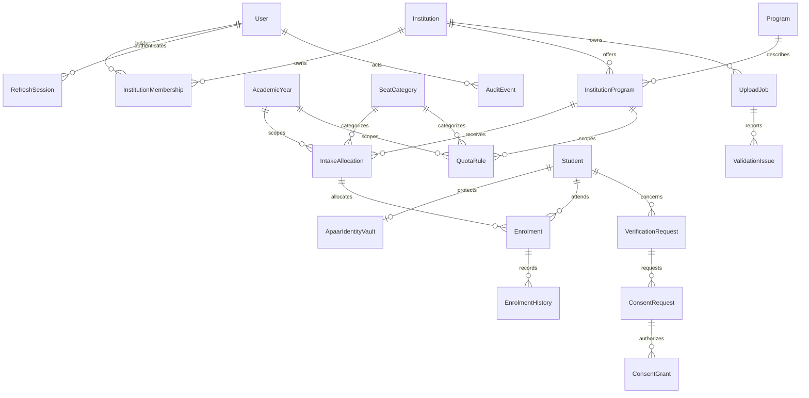
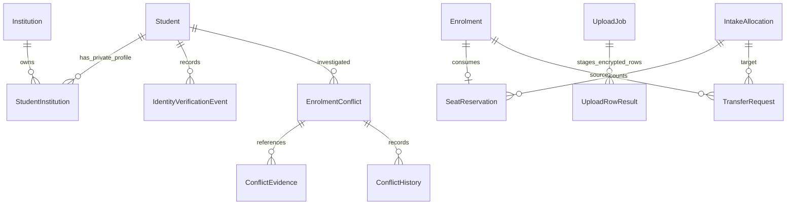

# Database relationships

**IMPLEMENTED:** referenced documents and indexes; MongoDB does not enforce relational foreign keys.

Ownership of an allocation/enrolment derives through offering → institution; it is not accepted from a caller's self-asserted tenant claim. Cross-institution conflicts may exist intentionally, but future responses must not disclose another institution's private records.

## Batch 2 additions — IMPLEMENTED

Unique indexes protect student/institution associations, institution roll numbers, linked user accounts (partial index), job/row positions, institution admission idempotency keys (partial index), enrolment reservations, transfer idempotency and canonical conflict pairs/rules. No global one-active-enrolment constraint is introduced. Tenant fields on enrolments are derived from validated allocations in services; they are indexed query projections, not client authority.
